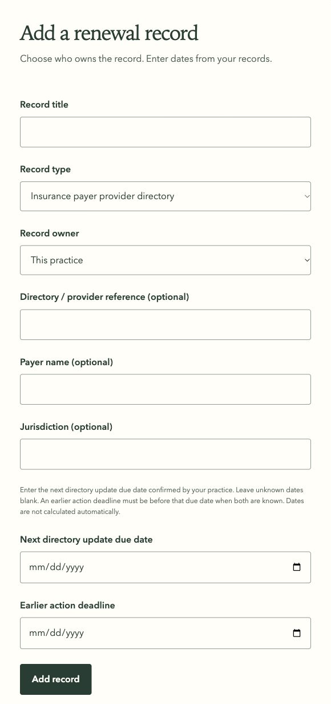

# Insurance payer provider directory production release

Status: **deployed and verified** on October 21, 2026 (America/Los_Angeles), following the user's explicit production release request. Open the [production register](https://license-radar.vercel.app/practice/register) and choose **Insurance payer provider directory**. A record can belong to the practice or one clinician.

## Release identity

- Canonical URL: https://license-radar.vercel.app
- Deployment: `dpl_9qwmwkqYcg4TmJhfp5eEtUkdgWw2`, independently confirmed READY at the canonical alias.
- Immutable candidate: https://license-radar-pjv615o67-arsens-projects-630b84fe.vercel.app
- Promotion: `2026-10-21T22:57:27.886Z` (15:57 PDT).
- Exact source: `380eaebe0e632e9152ae0a8ba31f91fd55900168c9872b82643710d3023487a9`, 431 inputs; verification run `8cd3784f-eebf-4b6b-b9aa-a812341574c0`, all 48 registered layers passed. See [implementation evidence](../research/2026-10-21-directory-implementation-evidence.md) for the recovered host-sleep interruption and complete results.
- At release time, source was the verified uncommitted workspace on `codex/renewal-record-numbers`, HEAD `cca99a7a6cb38524fb6c9461555855efb22605a5`. No commit or push was created during deployment. Subsequent Git bookkeeping preserves these application bytes; existing unrelated local changes remain separate.
- Upload matched the immutable archive: 429 files, 4,474,005 bytes; only the two expected gitignore files omitted. Three deliberate mismatch controls were rejected and original archive bytes restored.
- Previous production deployment: `dpl_5MjtZprMc1dUi1f8p2zEjKisoTFN`.

## Behavior and database rollout

`src/lib/register/types.ts` adds `insurance_payer_provider_directory`. `src/components/register/credential-fields.tsx` supplies payer/reference/jurisdiction fields, practice or clinician ownership, and an explicit next directory update due date. `src/components/renewals/completion-fields.tsx` requires a new future due date on confirmed completion. Existing workflow, history, evidence, calendar, dashboard and reminders support the type. Staff enter dates; no cadence is inferred or payer portal action performed.

Applied only `supabase/migrations/20261021210414_insurance_payer_provider_directory_records.sql` before application promotion. It widens `credentials_type_check` and replaces three private validator definitions. No tables, columns, grants, RLS policies, function signatures, payload versions, seed records, roles or Vault configuration changed. No directory backfill or production test record was created.

The complete normalized production catalog matched `tools/schema-contract.json`: 439 columns, 304 constraints, 232 functions, 1,806 grants, 148 indexes, seven policies, 49 RLS entries, one compared private schema and 11 triggers. Applied migrations increased from 17 to 18. Normalization retained the established platform/ACL comparison from prior releases.

## Automated release verification

The private operator workflow is `/private/tmp/license-radar-directory-production/release.mjs`, adapted from the preceding PCI release. Commands used pinned Node 24.21.0, Supabase CLI 2.119.0 and Vercel CLI 59.16.0. Each final operation below passed:

- `release.mjs prepare`, `baseline`, `dry`, `controls`: checked the passed 48-layer run, exact workspace source, current production identity, immutable upload contents, and mismatch rejection.
- `release.mjs snapshot before|refreshed|after|final` and `verify` for each stage: read-only aggregate comparisons over 48 original application/private tables. All 44 durable tables were unchanged; four scheduled-worker bookkeeping tables could advance. Auth users/identities, Storage object metadata, scheduled-job definitions, authority state and delivery ledger were unchanged. These aggregate snapshots verify preservation; they are not backups.
- `release.mjs migrate dry` then `migrate apply`: `supabase db push --linked --skip-vault` previewed and applied exactly the directory migration; seeds and roles were empty.
- `db.mjs directory-smoke`, followed by explicit result assertions: all 19 read-only production assertions passed, covering practice/clinician ownership, optional dates, invalid dates and deadline order, malformed ownership, covered-clinician rejection, old types, preserved PCI ownership, private helper permissions, direct-write denial, and all three validator whitelists.
- `release.mjs advisors before|after`: `supabase db advisors --type security --fail-on error` passed. The three existing warnings were byte-identical; zero errors and no added warnings.
- `smoke.mjs https://license-radar.vercel.app before|after|final`: 98 checks passed at each stage, covering public routes, anonymous redirects, private cache behavior, anonymous RPC/table denial and unauthenticated worker/webhook boundaries. No application data was written.
- `release.mjs deploy`, `metadata`, `promote`, `final`: deployed without assigning domains, independently checked candidate source/run/project/READY metadata, promoted separately, then confirmed the canonical alias. All 19 hosting setting metadata entries, including seven protected entries, were unchanged. Candidate HTTP returned the existing protection redirect (302); protection remained enabled, and canonical checks passed after promotion.
- `assets.mjs controls` and `assets.mjs https://license-radar.vercel.app final`: six synthetic private-value representation controls passed. Three anonymous pages and ten scripts (603,700 bytes) were fetched. `.tools/gitleaks dir --redact` on those fetched assets exited 0 with zero findings. Prior private-value files were absent, so equality scanning against actual retained secrets was unavailable; no actual-private-value scan success is claimed.
- `db.mjs post-release-worker`, followed by explicit result assertions: one genuine scheduled worker run succeeded after promotion at `2026-10-21T22:58:00.595793Z`. The existing one-minute cron configuration and command hash were preserved. One consumed attempt, one provider POST, and zero duplicate permissions were unchanged. No manual worker invocation, test reminder or monitor ping was used.
- Final release-document formatting, `git diff --check`, and exact source identity comparison passed.

The first post-migration snapshot encountered a temporary CLI database login role authentication failure. The same read-only snapshot passed when rerun sequentially; the migration, source, limits and assertions were unchanged. Original diagnostics remain private. Other dependent checks were rerun after the successful snapshot; no failed gate was waived.

Sanitized aggregate evidence: [release JSON](../research/2026-10-21-directory-production-release.json). Raw metadata, catalogs and operator diagnostics stay outside the repository. No production record contents, credentials or private monitor addresses were copied into release artifacts.

The release followed current [Supabase migration guidance](https://supabase.com/docs/guides/deployment/database-migrations) and [Vercel CLI deployment guidance](https://vercel.com/docs/cli/deploying-from-cli), with installed-command help checked before use.

## Signed-in UI verification

The live canonical register was inspected while signed in. Selecting the directory type displayed the directory/provider reference, payer name, jurisdiction and explicit next directory update due date. Practice ownership was available; selecting clinician ownership displayed the owning-clinician selector, and returning to practice hid it. No covered-clinician selector was present. The form was left blank, with directory type and practice ownership selected. No Add, Save, Archive, completion or evidence action was submitted. This is agent verification; human acceptance remains separate. Write workflows were exercised by the passed local verification suites.

## Recovery constraints

After a directory record exists, the preceding PCI-only deployment is not an unconditional compatible fallback. Retain fifth-type-capable register/history/evidence readers, the widened type CHECK, and validator support. Prefer a compatible forward repair or disabling new creation/conversion while preserving reads. Archiving does not restore old-reader compatibility. Do not coerce/delete records or immutable history, narrow the CHECK, or restore older whitelists. No live rollback, schema down migration, backup restore or real-inbox acceptance was rehearsed.
